<p align="center">
  
</p>

<h1 align="center">🎬 Reels Vault</h1>

<p align="center">
  <strong>Paste a reel URL. Get a transcript. Ask your AI about it.</strong>
</p>

<p align="center">
  
</p>

A local-first pipeline that extracts transcripts, music, frames, and metadata
from any Instagram reel, then organizes them into **Obsidian, Notion, or both** —
tagged by topic and creator so you can search across hundreds of reels.

The idea: instead of saving scattered bookmarks, you build a real library.
*"What do 50 creators say about hooks?"* → one search.

```
Instagram Reel → Download → Transcribe → Identify Music → File by Topic → AI-Ready
```

- **Extract** video, transcript, metadata, and music from any public reel
- **Organize** in Obsidian, Notion, or both — grouped by topic, not dumped in a pile
- **Classify with your AI** — the agent that saves a reel fills in niche, category, and industry
- **Connect** to Claude/Cursor via MCP so your AI can search your reels
- **No cloud, no paid APIs** — extraction runs on your machine (Instagram cookies may be needed for downloads; see Limitations)

---

## Quick Start

### Easiest — install as a Claude skill (Claude Code)

If you use [Claude Code](https://claude.com/claude-code), skip the MCP config
entirely. Install Reels Vault, then drop the bundled skill into your skills
folder:

```bash
curl -fsSL https://raw.githubusercontent.com/Overusedhydra/reels-vault/main/install.sh | bash
ln -s ~/reels-vault/skills/reels-vault ~/.claude/skills/reels-vault
```

> Installed somewhere other than `~/reels-vault`? Point the symlink at
> `<install-dir>/skills/reels-vault` instead.

Now just talk to Claude — no JSON to edit, no server to configure:

> *"Save this reel: https://www.instagram.com/reels/ABC123/"*
> *"What do creators say about hooks?"*

The skill finds your install automatically (via the path `connect.py` records)
and runs the same CLI under the hood. For other MCP clients (Claude Desktop,
Cursor, Continue), use the MCP server setup below instead.

### The easy way — use Claude (no terminal needed)

**Step 1:** Install Reels Vault (paste this in your terminal — one time only):

```bash
curl -fsSL https://raw.githubusercontent.com/Overusedhydra/reels-vault/main/install.sh | bash
```

**Step 2:** Open Claude Desktop → **Settings → Developer → Edit Config**. Paste this:

```json
{
  "mcpServers": {
    "reels-vault": {
      "command": "/Users/you/reels-vault/.venv/bin/python3",
      "args": ["/Users/you/reels-vault/mcp_server/server.py"]
    }
  }
}
```

> Replace `/Users/you/reels-vault` with the actual path. Run `pwd` in the
> `reels-vault` folder to find it.

**Step 3:** Quit and reopen Claude Desktop.

**Step 4:** Paste any reel link and tell Claude to save it:

> *"Save this reel: https://www.instagram.com/reels/ABC123/"*

That's it. Claude downloads it, transcribes it, finds the music, and files it
into your configured storage. No commands. No copy-pasting.

<p align="center">
  
</p>

Want to search what you've saved? Just ask:

> *"What do creators say about hooks?"*

---

<details>
<summary><strong>Prefer the terminal? (click to expand)</strong></summary>

```bash
# Install
curl -fsSL https://raw.githubusercontent.com/Overusedhydra/reels-vault/main/install.sh | bash
cd ~/reels-vault

# Save a reel
.venv/bin/reels-vault "https://www.instagram.com/reels/ABC123/" --topic hooks

# Better transcription (slower)
.venv/bin/reels-vault "URL" --topic marketing --whisper-model small

# Skip music ID (faster)
.venv/bin/reels-vault "URL" --topic ai --no-music

# If Instagram blocks the download
.venv/bin/reels-vault "URL" --cookies-from chrome
```

</details>

---

## How It Works

### 1. Install (one time)

```bash
curl -fsSL https://raw.githubusercontent.com/Overusedhydra/reels-vault/main/install.sh | bash
```

This clones the repo, installs all dependencies, and asks whether reels should
live in Obsidian, Notion, or both. Takes about 2 minutes the first time.

### 2. Connect Claude Desktop

Paste the MCP config into Claude Desktop's settings (see Quick Start above).
Now Claude can use Reels Vault — paste a reel link and it saves everything.

### 3. Your vault organizes itself

Every extracted reel gets valid YAML frontmatter:

```yaml
---
creator: Alex Hormozi
handle: hormozi
topic: content-creation
niche: unclassified
category: unclassified
industry: unclassified
classification: pending
tags:
  - ads
  - hooks
source: https://www.instagram.com/reels/ABC123/
source_id: abc123
extracted: 2026-06-29
---
```

The note starts as `classification: pending`; the AI agent that called the tool
then writes the final niche/category/industry with `scripts/classify.py`.
Your Obsidian structure:

<p align="center">
  
</p>

```
Your Vault/
  Reel Vault/
    Reels/
      content-creation/    ← reels grouped by topic
        hormozi-reel-2026-02-04-abc123.md
        frames/            ← optional WebP stills
      marketing/
        garyvee-reel-2026-02-04-def456.md
    index/                 ← auto-built niche/category/industry/topic indexes
    Creators/              ← per-creator pages
    Index.md               ← Open in Obsidian for the Dataview overview
```

<p align="center">
  
</p>

Install the [Dataview](https://github.com/blacksmithgu/obsidian-dataview)
plugin in Obsidian to use the generated `Index.md` dashboard.

Each note can embed **key frames** — WebP stills pulled every
`--frame-interval` seconds, capped at `--frame-max-width` pixels (default
1280), under a `Visual Frames` heading. Skip them with `--no-frames`.
Notion-only storage skips frames because Notion has no matching image workflow.

### 4. Let Claude do it for you (recommended — no terminal!)

This is the easiest way to use Reels Vault. After a one-time setup, you just
**talk to Claude** — paste a reel link and it does everything:

> *"Save this reel to my vault: https://www.instagram.com/reel/ABC123/"*

Claude downloads it, transcribes it, finds the music, and files it away. No
commands, no copy-pasting transcripts. It can also search everything you've
saved (*"What do creators say about hooks?"*).

**One-time setup (about 2 minutes):**

1. Open Claude Desktop → **Settings → Developer → Edit Config**. (This opens a
   file called `claude_desktop_config.json`.)
2. Paste in the block below.
3. Replace the **3 paths** with your real ones (see the tip under the block).
4. Save the file and fully quit + reopen Claude Desktop.

```jsonc
{
  "mcpServers": {
    "reels-vault": {
      "command": "/path/to/reels-vault/.venv/bin/python3",
      "args": ["/path/to/reels-vault/mcp_server/server.py"],
      "env": { "REELS_VAULT_PATH": "/path/to/your-vault/Reel Vault" }
    }
  }
}
```

> **Tip — getting the paths right:** in the `reels-vault` folder, run `pwd` in
> your terminal to print its full path. Swap that in for `/path/to/reels-vault`
> (both times). For the last line, use the `Reel Vault` folder that
> `connect.py` created inside your Obsidian vault.

Once it's connected, Claude can `extract_reel`, `search_reels`, `list_topics`,
`list_creators`, `read_note`, `classify_reel`, `list_unclassified`, `reindex`,
and `vault_status` — all by itself.

> Prefer doing it by hand? The `extract_reel.py` command in step 2 above always
> works without any of this.

---

## Notion, Obsidian, or Both

`connect.py` stores one `storage` setting: `obsidian`, `notion`, or `both`.

```bash
# Obsidian only
python3 scripts/connect.py /path/to/your/ObsidianVault

# Notion only (creates a database under the parent page)
python3 scripts/connect.py --storage notion \
  --token "$NOTION_TOKEN" --parent-page-id "https://www.notion.so/..."

# Both
python3 scripts/connect.py --storage both /path/to/your/ObsidianVault \
  --token "$NOTION_TOKEN" --parent-page-id "https://www.notion.so/..."
```

The Notion integration must be shared with the parent page. The database is
created automatically; pass `--database-id` to reuse an existing one. Tokens
are stored in `~/.config/reels-vault/config.json` with `0600` permissions.

## Classification

Extraction deliberately leaves classification pending. The AI agent that saved
the reel reads the transcript/caption and submits its own labels:

```bash
python3 scripts/classify.py --source "https://www.instagram.com/reel/ABC123/" \
  --metadata-json '{"niche":"business","category":"marketing","industry":"education","tags":["ads"]}'

python3 scripts/classify.py --list-unclassified
```

`taxonomy.json` is optional. Create it only if you want to restrict values
(`cp taxonomy.example.json ~/.config/reels-vault/taxonomy.json`); otherwise
freeform labels are accepted. In both-storage mode the same metadata is written
to Obsidian and the matching Notion page.

## Output Example

```markdown
---
creator: Alex Hormozi
handle: hormozi
topic: content-creation
niche: unclassified
category: unclassified
industry: unclassified
classification: pending
tags:
  - ads
  - hooks
source: https://www.instagram.com/reels/ABC123/
source_id: abc123
extracted: 2026-06-29
---

## Transcript
*Language detected: en*

Here's how to take a company's ads from this to this...

## Timestamped Transcript
[00:00] Here's how to take a company's ads from this to this.
[00:02] So ads are made up of three parts.
[00:03] Hook, meat, CTA.

## Visual Frames
![[Reels/content-creation/frames/hormozi-reel-2026-02-04-abc123/frame-00-00-05.000.webp]]
![[Reels/content-creation/frames/hormozi-reel-2026-02-04-abc123/frame-00-00-10.000.webp]]
```

## Whisper Models

| Model  | Speed    | Accuracy | Memory  |
|--------|----------|----------|---------|
| tiny   | Fastest  | Lower    | ~1 GB   |
| base   | Fast     | Good     | ~1 GB   |
| small  | Moderate | Better   | ~2 GB   |
| medium | Slow     | Great    | ~5 GB   |
| large  | Slowest  | Best     | ~10 GB  |

---

## Requirements

- **Python** 3.10+ (enforced by `setup.sh`)
- **ffmpeg** (auto-installed on macOS/Linux via Homebrew/apt)
- **yt-dlp**, **Whisper**, **shazamio**, **Playwright**, **PyYAML** — installed by `setup.sh`
- ~1 GB disk for the Whisper `base` model

**macOS / Linux:** run `./setup.sh`.
**Windows:** install [Python](https://python.org), [ffmpeg](https://ffmpeg.org/download.html),
then `pip install -e ".[mcp]"` inside a venv (or `pip install -r requirements.txt`
for the runtime dependencies only).

## Limitations

- Instagram rate-limits and changes often. If a download fails, retry with
  `--cookies-from chrome` (or firefox/safari) to authenticate.
- Whisper `base` is fast but not perfect — use `small`/`medium` for accuracy.
- Shazam works on the audio mix; speech-heavy reels may not ID a track.
- Respect creators' content and Instagram's Terms of Service. For personal
  research/learning.

## License

MIT — see [LICENSE](LICENSE).

## Contributing

Issues and PRs welcome.

## Acknowledgments

- [yt-dlp](https://github.com/yt-dlp/yt-dlp) — video downloading
- [openai-whisper](https://github.com/openai/whisper) — transcription
- [shazamio](https://github.com/dotenv-io/shazamio) — music identification
- [MCP](https://github.com/modelcontextprotocol) — AI tool integration
